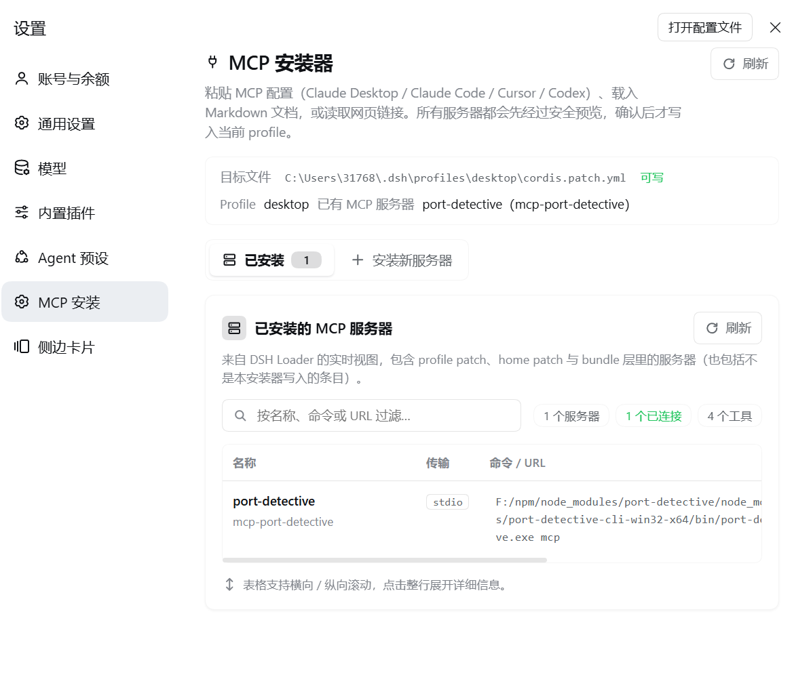
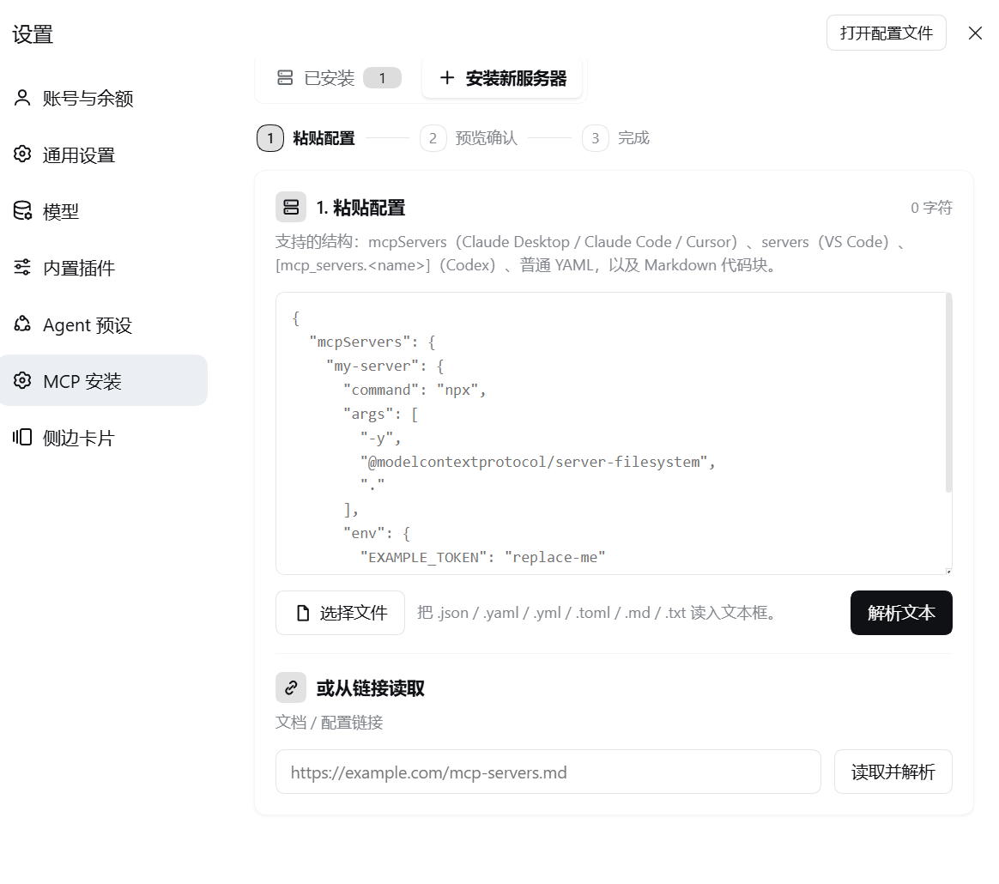

# DSH MCP Installer

在 DSH「设置 → MCP 安装」中导入并管理 MCP 服务器，配置写入当前 profile 的 `cordis.patch.yml`。

## 快速开始

检查 npm 上当前发布版本：

```bash
npm view dsh-mcp-installer version
```

普通 DSH CLI 用户可安装到 `web` profile：

```bash
dsh plugin --profile web add dsh-mcp-installer@latest
```

将 `web` 替换为你实际使用的非 Desktop profile。安装后打开或重启该 profile，在 **设置 → MCP 安装** 中使用。

DSH Desktop 的 `desktop` profile 由 Desktop 自带的 DSH 命令管理。先启动 Desktop 初始化 profile，再在 Desktop 提供的命令环境中运行：

```bash
dsh plugin --profile desktop add dsh-mcp-installer@latest
```

不要用单独安装的通用 `dsh` CLI 管理 Desktop 的保留 profile。

## 使用 MCP 安装器

打开 DSH **设置 → MCP 安装**。页面顶部会显示当前 profile 的目标配置文件和可写状态。

### 查看已安装服务器

「已安装」页展示当前 DSH Loader 中生效的 MCP 服务器，包括来源层、传输方式、连接状态和工具数。可按名称、命令或 URL 搜索；点击一行可展开详情。刷新可重新读取实时状态。



### 添加服务器

1. 选择 **安装新服务器**。
2. 粘贴 MCP 配置，或选择 `.json`、`.yaml`、`.yml`、`.toml`、`.md`、`.markdown`、`.txt` 文件。也可输入文档或配置网页链接并选择 **读取并解析**。
3. 选择 **解析文本**（链接导入会自动解析），检查每个服务器的传输方式、命令或 URL 和安全风险；按需确认风险提示，并选择要安装的服务器。
4. 选择 **安装所选服务器**。配置写入当前 profile 的 `cordis.patch.yml`；完成后回到「已安装」查看运行状态。新会话或重启后生效；启用 HMR 时会自动重载。



支持 `mcpServers`（Claude Desktop / Claude Code / Cursor）、`servers`（VS Code）、`[mcp_servers.<name>]`（Codex）、普通 YAML 和 Markdown 代码块，也支持 Claude/Codex CLI 命令。支持 `stdio` 与 `streamable-http`，不支持 SSE。

编辑或删除仅适用于当前 profile patch 中可唯一定位的服务器。来自 home patch、bundle 等其他来源的服务器需在所属配置层管理。

示例：

```json
{
  "mcpServers": {
    "filesystem": {
      "command": "npx",
      "args": ["-y", "@modelcontextprotocol/server-filesystem", "."]
    }
  }
}
```

## 安全说明

- 导入的 env/header 值会写入 profile patch；敏感值建议使用 DSH 支持的 `!!js` 环境变量表达式。页面只显示键名，编辑时保留原值。
- 高风险命令或 URL 需要确认；网页导入会拒绝本机和内网地址。

## 开发

```bash
npm install
npm run build
npm run typecheck
npm test
```

许可证：MIT
