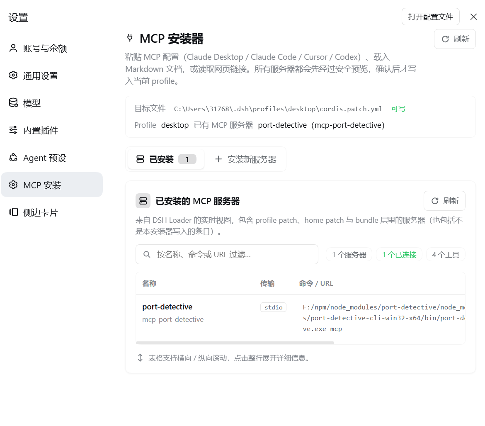
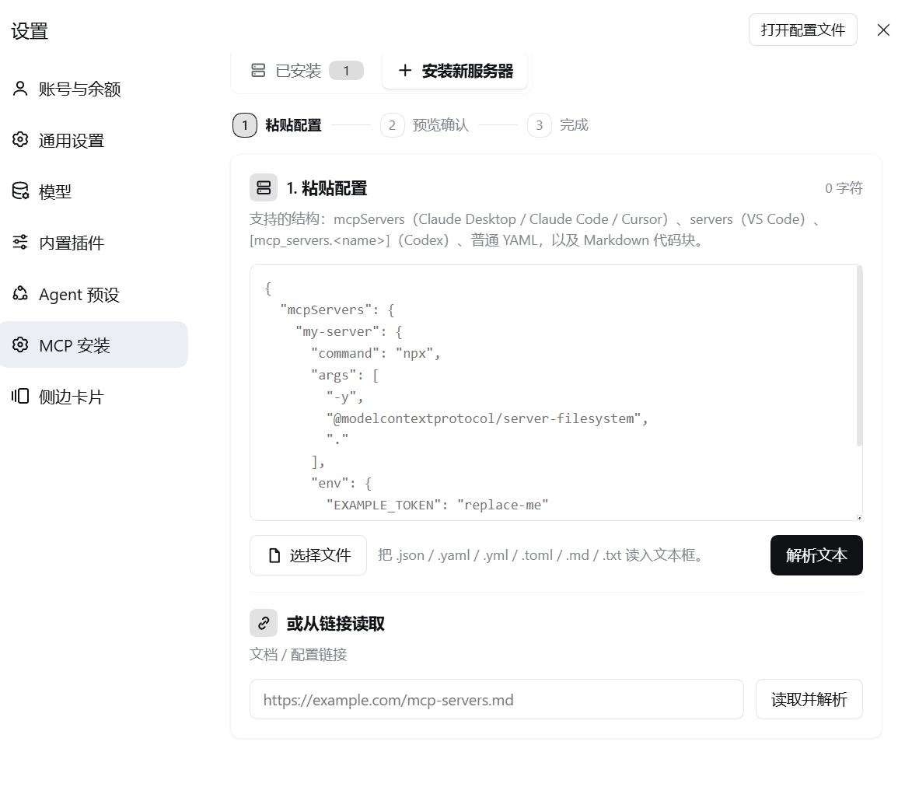

# dsh-mcp-installer

在 DSH「设置 → **dsh-mcp-installer**」中导入、编辑、测试并管理 MCP 服务器，配置写入当前 profile 的 `cordis.patch.yml`。

关键点：**写入前自动备份、冲突时不会整批失败、装之前就能测出连不上**。

## 快速开始

推荐使用 v1.2.0 及以上版本（新增备份回滚、连接测试、预览可编辑与冲突策略）。

检查 npm 上当前发布版本：

```bash
npm view dsh-mcp-installer version
```

普通 DSH CLI 用户可安装到 `web` profile：

```bash
dsh plugin --profile web add dsh-mcp-installer
```
指定版本
```bash
dsh plugin --profile web add dsh-mcp-installer@1.2.0
```
安装最新版本
```bash
dsh plugin --profile web add dsh-mcp-installer@latest
```

将 `web` 替换为你实际使用的非 Desktop profile。安装后打开或重启该 profile，在 **设置 → dsh-mcp-installer** 中使用。

DSH Desktop 的 `desktop` profile 由 Desktop 自带的 DSH 命令管理。先启动 Desktop 初始化 profile，再在 Desktop 提供的命令环境中运行：

```bash
dsh plugin --profile desktop add dsh-mcp-installer
```

不要用单独安装的通用 `dsh` CLI 管理 Desktop 的保留 profile。

## 使用 dsh-mcp-installer

打开 DSH **设置 → dsh-mcp-installer**。页面顶部会显示当前 profile 的目标配置文件、可写状态、内容指纹和已有备份数量。

### 查看已安装服务器

「已安装」页展示当前 DSH Loader 中生效的 MCP 服务器，包括来源层、传输方式、启用状态、连接状态和工具数。可按名称、命令或 URL 搜索；点击一行可展开详情。刷新可重新读取实时状态。



每一行都可以：

- **测试连接** —— 真正跑一次 MCP 握手，报告成功 / 失败在哪一步、耗时、服务端名称与版本、工具列表，以及启动时的 stderr。
- **启用 / 禁用** —— 不删配置行，只写 `disabled: true`，临时停用排障。
- **编辑 / 删除** —— 仅对当前 profile patch 新增的行可用。

### 添加服务器

1. 选择 **安装新服务器**。
2. 粘贴 MCP 配置，或选择 `.json`、`.yaml`、`.yml`、`.toml`、`.md`、`.markdown`、`.txt` 文件。也可输入文档或配置网页链接并选择 **读取并解析**。
3. 选择 **解析文本**（链接导入会自动解析），然后**逐行检查并直接修改**：
   - 名称（被自动归一化或与已有服务器重名时，在这里改）；
   - `command` / `args` / `url`；
   - `env` / `headers` 的键值（可增删，敏感值默认隐藏）。
   改动会立即重新做安全评估，风险徽章实时更新。
4. 有 `${VAR}` 占位符或疑似明文密钥时，用 **改用环境变量** 一键转成 `!!js process.env.VAR`，密钥就不会落盘。
5. 选择冲突策略：**跳过已存在**（默认，部分成功）/ **覆盖已有**（仅 profile 层）/ **整批失败**。
6. 选择 **安装所选服务器**。配置写入当前 profile 的 `cordis.patch.yml`，写入前自动生成带时间戳的备份；完成后页面会轮询直到服务器激活或超时并说明原因。



支持 `mcpServers`（Claude Desktop / Claude Code / Cursor）、`servers`（VS Code）、`[mcp_servers.<name>]`（Codex）、普通 YAML 和 Markdown 代码块，也支持 Claude/Codex CLI 命令。支持 `stdio` 与 `streamable-http`，不支持 SSE。

编辑或删除仅适用于当前 profile patch 中可唯一定位的服务器。来自 home patch、bundle 等其他来源的服务器需在所属配置层管理。

示例：

```json
{
  "mcpServers": {
    "filesystem": {
      "command": "npx",
      "args": ["-y", "@modelcontextprotocol/server-filesystem", "."]
    }
  }
}
```

### 备份、回滚与导出

- 每次写入前，插件把当时的配置快照成同目录的 `<文件名>.bak-<时间戳>`，默认保留 20 份，更旧的自动清理。
- 「已安装」页的 **备份与回滚** 区列出全部备份（时间、大小、摘要），可一键回滚；回滚前同样会先备份当前内容，所以回滚本身也可撤销。
- **导出脱敏配置** 产出可直接粘贴到其它机器的 `mcpServers` JSON，所有疑似密钥的值都会替换成 `${VAR}` 占位符。

### 并发写入保护

配置里同时写着 Config Editor、Plugin Manager 和本插件。每次写入都会带上 UI 预览时的内容指纹（SHA-256）：如果这期间文件被别的程序改过，写入会被拒绝并提示重试，而不是静默覆盖别人的修改。

## 安全说明

- 导入的 env/header 值会写入 profile patch。插件会按值形态识别疑似明文密钥（`sk-…`、`ghp_…`、`AKIA…`、JWT、Bearer token 等），并建议改成 `!!js process.env.X`。页面只显示键名，编辑时保留原值。
- 高风险命令或 URL 需要逐项确认；确认绑定到**这份配置的内容指纹**，同名不同内容不能复用确认。
- `docker` / `podman` 不再被当作无风险命令：`--privileged`、把宿主根目录挂进容器、挂载 `docker.sock`、`--network host`、宿主 PID/IPC 命名空间、`--cap-add` 都会告警。
- `npx` / `uvx` / `bunx` 使用未固定版本的包时，会提示供应链漂移风险。
- 网页导入会拒绝本机和内网地址，整条重定向链共用一个超时，并在请求前复核 DNS 结果以缓解 rebinding。

## 开发

```bash
npm install
npm run build
npm run typecheck
npm test
```

测试覆盖 Host 侧的解析、安全评估、配置写入与回滚、连接探测，以及十二个 HTTP 路由的集成行为。

许可证：MIT
